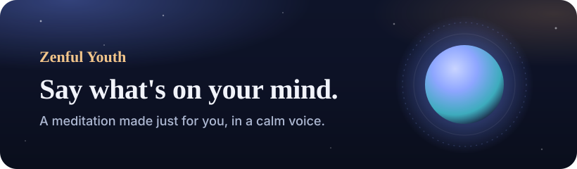
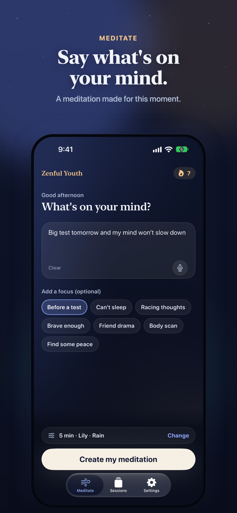
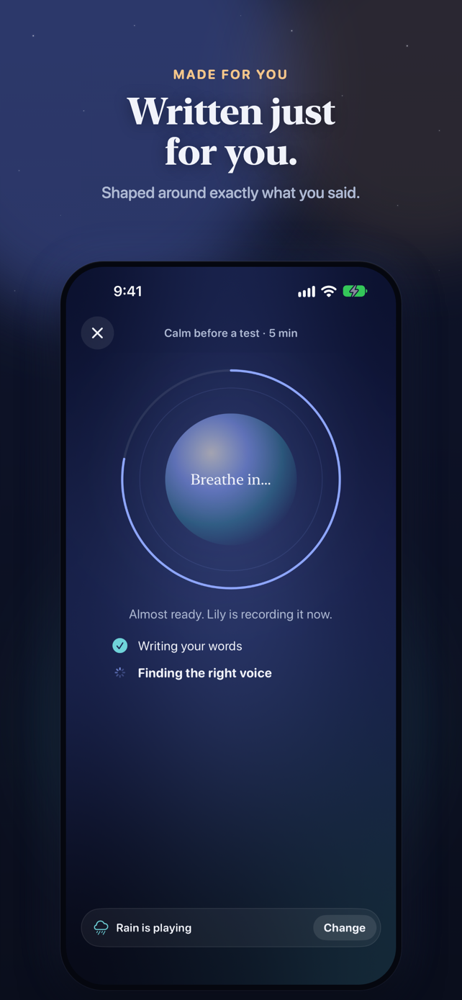
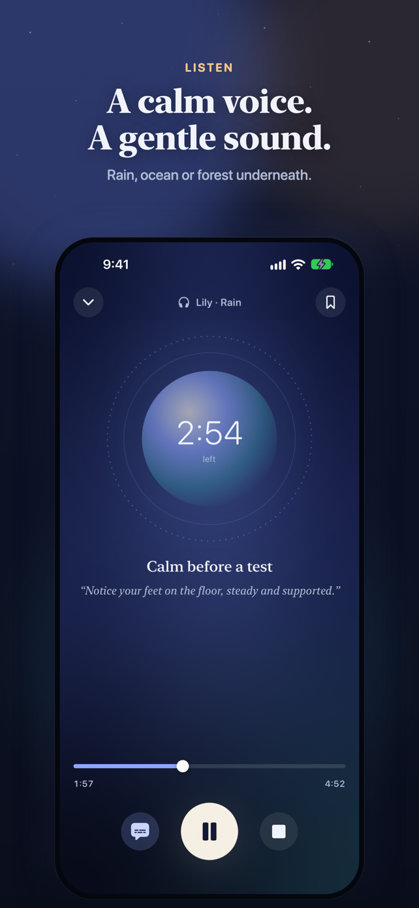
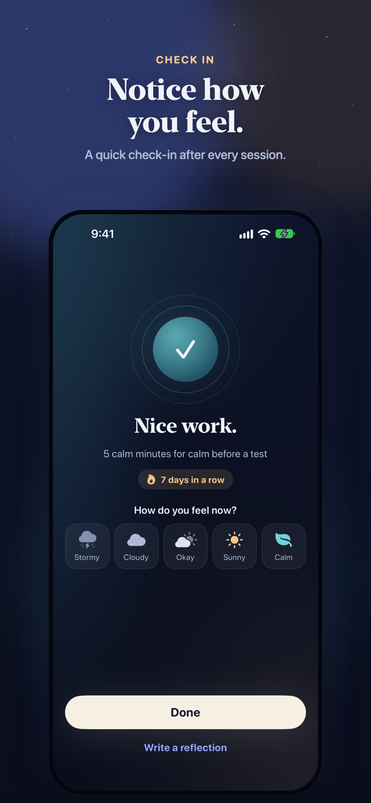
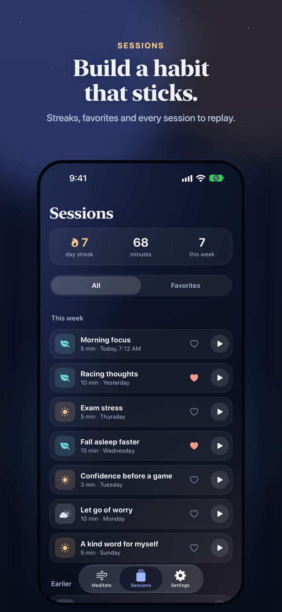
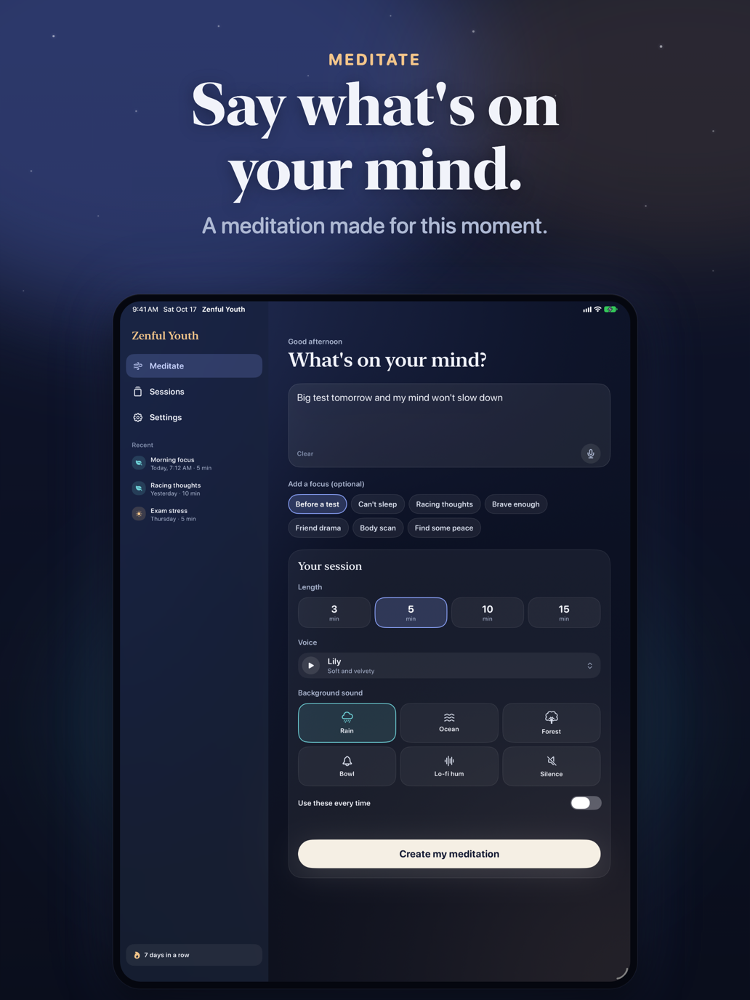
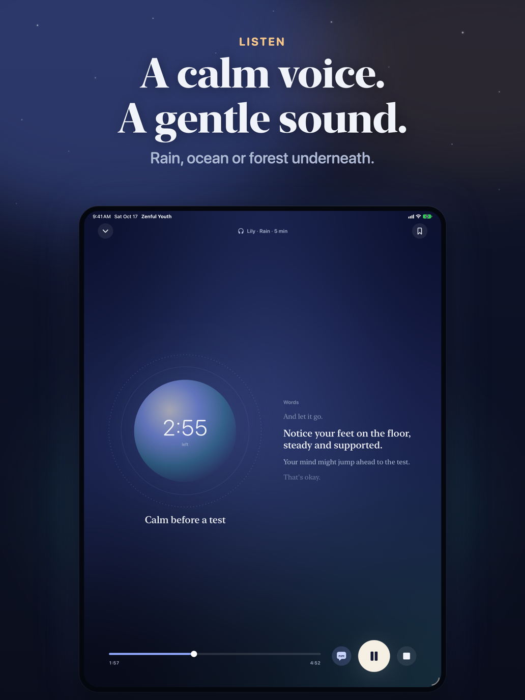

  

# Zenful Youth

A meditation app for every age, about finding your inner youth: the lighter, curious, younger-at-heart you that's still in there. Say what's on your mind, and Zenful Youth writes a guided meditation made for exactly that, then guides you through it with a calm voice over a gentle background sound.

## Screenshots

### iPhone

  
  
  
  
  

### iPad

  
  

## Features

- A new meditation every time, written around what you type, say, or pick
- 3, 5, 10 or 15 minutes, with pauses and breathing cues built in
- Eight calm narrator voices, each with a preview
- Background sounds: rain, ocean, forest, singing bowl, lo-fi hum, or silence
- A breathing orb and captions that follow along
- A mood check-in and optional reflection after every session
- Streaks, favorites, and replays of any past session
- Stop partway and pick up where you left off
- Background playback with Lock Screen controls and a Live Activity
- A gentle daily reminder
- iPad layout with a sidebar and a side-by-side words pane
- VoiceOver, Dynamic Type, Reduce Motion and Reduce Transparency support

## Requirements

- iOS 27.0+ on an iPhone or iPad that supports Apple Intelligence, with it turned on
- For spoken meditations, an [ElevenLabs](https://elevenlabs.io) account and key. Without one, meditations are shown as on-screen text.

## Privacy

Meditations are written on your device, and there are no accounts, analytics, or ads. Your sessions stay on your device. See our full [Privacy Policy](PRIVACY.md).

## Support

Have a question or found a bug? Check our [Support & FAQ](SUPPORT.md) page or [open an issue](https://github.com/idevtim/zenfulyouth/issues).

## License

All rights reserved.
